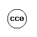

My name is Kryštof Pešek (Kof). I am an independent developer, electronic musician, and small-web enthusiast based in Prague.

My work bridges the gap between deep Linux system administration and creative expression—building custom zero-bloat audio DSP tools in C and SuperCollider, sonifying live environmental telemetry, and exploring offline-first digital experiences and analog photography.

If not stated explicitly otherwise, all my works presented here are licensed under:

---

### Keeping the machines humming

Everything I build—from autonomous 24/7 power-grid sonification nodes to lock-free audio visualizers—is crafted by hand and shared freely in the public domain. There are no paywalls, subscriptions, or tracking.

If my tools, sounds, or notes have brought you value, consider fueling the work:

**[👉 Support on Ko-fi (ko-fi.com/kof86)](https://ko-fi.com/kof86)**

Every contribution directly covers hardware sensors, analog darkroom chemistry (Rodinal), and late-night electricity.

---

Do not wait for any miracles, just do something...

[_--kof_](https://github.com/k0f)
